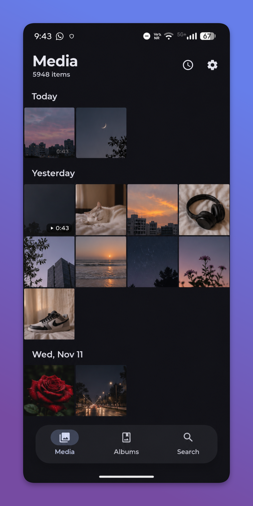
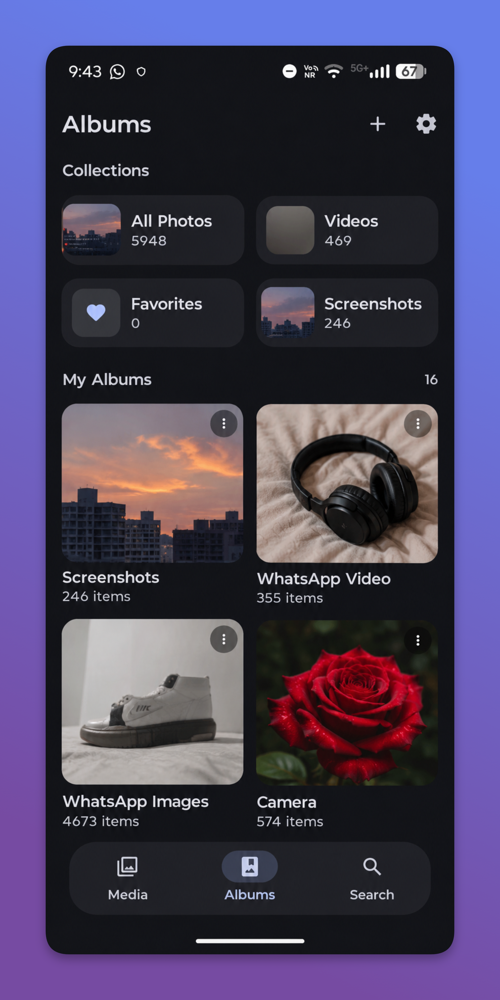
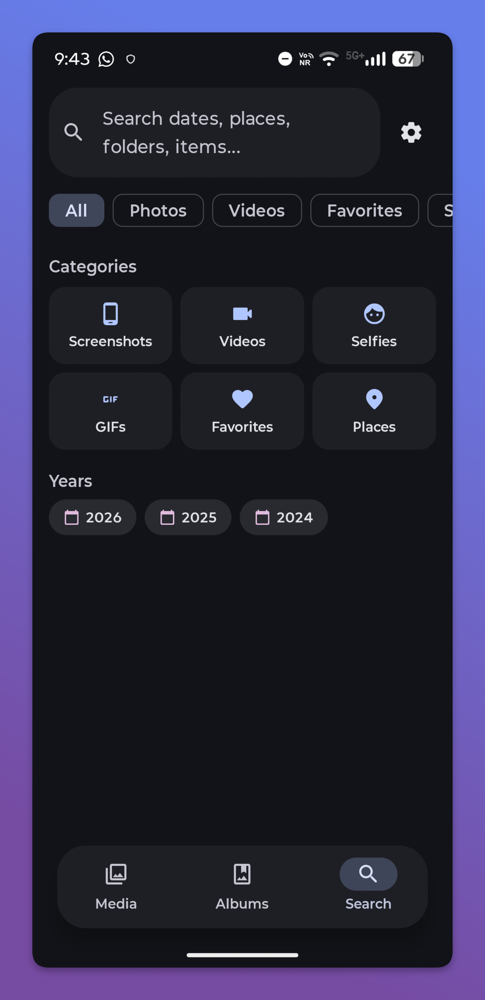

<h1 align="center">Gallery</h1>

<p align="center">
  A fast, private, fully offline native Android gallery inspired by the Realme/ColorOS Gallery.<br>
  Built with Kotlin and Jetpack Compose, with smooth 120Hz animations.<br>
  No ads. No tracking. No network access.
</p>

<p align="center">
  
  
  
  
  
</p>

<p align="center">
  <a href="../../releases/latest"><b>Download</b></a> &nbsp;•&nbsp;
  <a href="https://youtube.com/shorts/pOFYOK_dr6w"><b>Watch the demo</b></a> &nbsp;•&nbsp;
  <a href="#-features"><b>Features</b></a> &nbsp;•&nbsp;
  <a href="#-installation"><b>Install</b></a> &nbsp;•&nbsp;
  <a href="#-build-from-source"><b>Build</b></a>
</p>

---

## 📸 Screenshots

<p align="center">
  
  &nbsp;&nbsp;
  
  &nbsp;&nbsp;
  
</p>

<p align="center">
  <sub><b>Photos timeline</b> &nbsp;•&nbsp; <b>Albums</b> &nbsp;•&nbsp; <b>Search</b></sub>
</p>

## 🎬 Demo

<p align="center">
  <a href="https://youtube.com/shorts/pOFYOK_dr6w">
    
  </a>
</p>

<p align="center">
  <sub>See the timeline, the swipe-to-dismiss viewer, and search in action.</sub>
</p>

---

## ✨ Features

### 🖼 Photos
- Timeline grid grouped by day, month, and year with sticky headers
- Pinch to change grid density, plus a fast scroller with a date bubble
- Long-press and drag to multi-select, with batch share, delete, favorite, move, copy, and hide

### 📁 Albums
- Automatic albums from your folders, plus pinned system albums (Favorites, Screenshots, Recently Deleted, Hidden)
- Create, rename, reorder, and pin custom albums

### 🔍 Viewer
- Shared-element transitions from the grid
- Pinch zoom, double-tap zoom, and pan
- Fluid swipe-down-to-dismiss that returns the photo to its thumbnail
- Predictive back gesture support
- Details sheet with full EXIF and GPS info
- Video playback with speed, mute, and loop controls
- Motion photo and animated GIF/WebP support

### 🎨 Editor
- Crop, rotate, flip, and straighten
- Brightness, contrast, saturation, warmth, highlights, shadows, sharpness, and vignette
- Filters with intensity control, plus markup tools
- Save as a copy or overwrite, preserving EXIF

### 🔎 Search
- Instant, typo-tolerant results as you type
- Natural-language dates such as `yesterday`, `March 2025`, and `last Diwali`
- Combined queries such as `videos from goa 2024`
- Search by filename, album, media type, and place

### 🔐 Private vault and trash
- Biometric/PIN-protected vault with encrypted storage
- Recently Deleted with restore and permanent delete

### 📲 Default gallery support
- Opens images and videos from other apps and works as a photo/video picker

---

## ⚡ Performance

- Smooth scrolling at up to 120Hz on libraries of 20k+ items
- Thumbnails decoded at exact display size
- All animations run in the graphics layer, so nothing recomposes per frame
- Cached grid state for a fast cold start

## 🔒 Privacy

- No network calls, analytics, ads, or tracking
- No Google Play Services or Firebase
- Scoped storage only, with no all-files access permission
- Search index and vault data stay in the app's private storage

---

## 🛠 Tech Stack

| Area | Choice |
|---|---|
| Language | Kotlin |
| UI | Jetpack Compose, Material 3 |
| Architecture | MVVM, Clean Architecture, single activity |
| DI | Hilt |
| Async | Coroutines and Flow |
| Media access | MediaStore, Paging 3 |
| Image loading | Coil 3 |
| Video | Media3 ExoPlayer |
| Storage | Room (with FTS search index), DataStore |
| Security | BiometricPrompt, Jetpack Security / Tink |
| Performance | Baseline Profile, Macrobenchmark, JankStats |

---

## 📥 Installation

1. Download the latest APK from the [Releases](../../releases) page.
2. Allow "Install unknown apps" for your browser or file manager if prompted.
3. Grant media access on first launch.
4. To make it your default gallery, pick it when an app asks "Open with", or set it under **Settings > Apps > Default apps**.

**Requirements:** Android 10 (API 29) or higher

## 🧱 Build from Source

```bash
git clone https://github.com/<your-username>/<your-repo>.git
cd <your-repo>
./gradlew assembleDebug
```

For accurate performance, always test on a release-like build, since debug builds make Compose animations look much laggier than they are:

```bash
./gradlew assembleBenchmark   # or assembleRelease with your signing config
```

Requires the latest stable Android Studio and JDK 17+.

---

## 🗺 Roadmap

- [x] Photos, Albums, Viewer, Editor, Vault, Trash
- [x] Smart text search with natural-language dates
- [ ] Background indexing with progress indicator
- [ ] Semantic search (describe a photo to find it)
- [ ] Similar photos and duplicate finder

## 📝 Notes

- Developed and tested mainly on the Motorola Edge 70, so other devices may behave differently.
- Place search needs photos with GPS data in their EXIF.

## 🤝 Contributing

Issues and pull requests are welcome. For larger changes, please open an issue first to discuss what you'd like to change.
